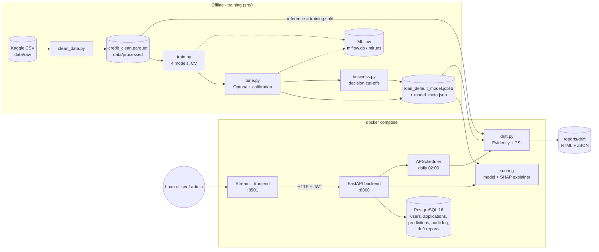

# Loan Default Prediction

[](https://github.com/ExploringVD/Loan-Defalut-Prediction/actions/workflows/ci.yml)

An end-to-end credit-risk system. It predicts the probability that a loan will **default**, turns it into an
**APPROVE / REVIEW / REJECT** decision, explains every decision with **SHAP**, serves it in real time
(**FastAPI** backend + **Streamlit** frontend), logs everything to **PostgreSQL**, and watches for **data drift**.

| Target (HCL synopsis) | Result |
|---|---|
| ROC-AUC >= 0.85 | **0.952** on the held-out test split (calibrated XGBoost) |
| NPA reduction >= 30% (simulated) | **79.8%** (REVIEW approved) to **93.1%** (REVIEW rejected) vs approving everyone |
| Explain every prediction | top 5 SHAP reasons for each application, as a chart and as sentences |
| Real-time scoring | median **32 ms** per request (p95 41 ms), model + SHAP part 23 ms |
| Monitoring | daily drift check (Evidently + PSI), simulated drift batch flagged, no-drift batch not |

Everything is Python 3.12. Built to run on a MacBook Air with 8 GB RAM.

---

## Contents

1. [Architecture](#architecture)
2. [Dataset](#dataset)
3. [Results](#results)
4. [Screenshots](#screenshots)
5. [Run locally](#run-locally)
6. [Run with Docker](#run-with-docker)
7. [Use the model in your own code](#use-the-model-in-your-own-code)
8. [API and frontend](#api-and-frontend)
9. [Batch scoring (CSV)](#batch-scoring-csv)
10. [Drift monitoring and retraining](#drift-monitoring-and-retraining)
11. [Tests and CI](#tests-and-ci)
12. [Project structure](#project-structure)
13. [Limitations](#limitations)
14. [Credits](#credits)

---

## Architecture



- **One pipeline everywhere:** the saved file is a full scikit-learn pipeline (imputation + encoding + calibrated
  XGBoost). Training, the API, SHAP and the drift checks all load this one file. No preprocessing code is copied.
- **One conversion:** `to_model_input()` in `src/clean_data.py` turns the 11 raw application fields into model input.
- **One band rule:** `src/decision.py` with the cut-offs from `models/model_meta.json` (never hard-coded).
- The frontend never touches the model or the database. It only calls the API.

---

## Dataset

**Kaggle "Credit Risk Dataset"** (laotse): <https://www.kaggle.com/datasets/laotse/credit-risk-dataset>

32,581 loan applications, 12 columns. Target `loan_status`: 1 = defaulted (21.8% in the raw file), 0 = repaid.
Every column is known at application time, and there is **no date column**.

| Column | Meaning |
|---|---|
| person_age, person_income, person_emp_length | Age, yearly income, years employed |
| person_home_ownership | RENT, MORTGAGE, OWN, OTHER |
| loan_intent | EDUCATION, MEDICAL, VENTURE, PERSONAL, DEBTCONSOLIDATION, HOMEIMPROVEMENT |
| loan_grade | Lender's risk grade A (safest) ... G |
| loan_amnt, loan_int_rate | Loan amount and interest rate (%) |
| loan_percent_income | Loan amount / yearly income |
| cb_person_default_on_file | Credit bureau: defaulted before? (Y/N) |
| cb_person_cred_hist_length | Credit history length (years) |
| **loan_status** | **Target: 1 = defaulted, 0 = repaid** |

**Download (only needed to re-run the cleaning).** The raw file is not in git. The cleaned file
`data/processed/credit_clean.parquet` **is** in git, so training, the API, Docker and the tests all work without the raw file.

- Browser: open the Kaggle link, click *Download*, unzip, and put `credit_risk_dataset.csv` in `data/raw/`.
- Kaggle CLI (needs an API token in `~/.kaggle/kaggle.json`):
  ```bash
  pip install kaggle
  kaggle datasets download -d laotse/credit-risk-dataset -p data/raw --unzip
  ```

**Cleaning (`src/clean_data.py`):** 32,581 rows, minus 165 exact duplicates, 5 rows with age > 100 and 2 rows with
employment length > age - 14, leaves **32,409 rows** (21.9% default). Cleaning adds `loan_id`, `loan_grade_num`
(A=1 ... G=7) and turns Y/N into 1/0. Missing values (`loan_int_rate` 9.5%, `person_emp_length` 2.7%) are filled in
**inside** the model pipeline, learned from the training split only.

**Split (`src/load_data.py`):** stratified 70 / 15 / 15 = 22,685 train / 4,862 validation / 4,862 test,
21.9% default in each, `random_state=42`. The test split was used **once**, for the final numbers.

**Features:** 11 in total. 9 numeric: age, income, employment length, loan amount, interest rate, loan as % of income,
grade number, past default, credit history length. 2 categorical: home ownership and loan purpose.

---

## Results

All numbers come from the files in `reports/`, where they are saved unrounded.

### Model comparison (validation split, `reports/model_comparison.md`)

| Model | Imbalance handling | 5-fold CV ROC-AUC | Val ROC-AUC | Val PR-AUC | Val KS |
|---|---|---|---|---|---|
| **XGBoost** (chosen for tuning) | scale_pos_weight | 0.942 | **0.955** | 0.912 | 0.772 |
| XGBoost + SMOTE | SMOTE inside an imblearn Pipeline | 0.943 | 0.952 | 0.912 | 0.771 |
| Random Forest | class_weight="balanced_subsample" | 0.930 | 0.940 | 0.896 | 0.748 |
| Logistic Regression | class_weight="balanced" | 0.873 | 0.879 | 0.726 | 0.601 |

SMOTE adds nothing beyond noise. Trees beat Logistic Regression because the data has strong step patterns
(grade C -> D: 21% -> 59% default; loan > 30% of income: 70% default).

### Final model (`reports/final_model.md`)

XGBoost tuned with **Optuna** (50 trials on the CV mean), then **isotonic calibration**
(`CalibratedClassifierCV`, cv=3), so a predicted 0.30 means about a 30% chance of default. Refit on
train + validation, then evaluated **once** on the test split:

| Test split (4,862 loans) | Value |
|---|---|
| **ROC-AUC** | **0.952** |
| PR-AUC | 0.909 |
| KS statistic | 0.767 |
| Brier score | 0.0514 |
| Expected calibration error | 0.004 |
| At threshold 0.5 | precision 0.975, recall 0.726 (772 of 1,063 defaults caught, 20 of 3,799 good loans flagged) |

`python src/test_model.py` (or `make test-model`) prints the same check next to two benchmarks refit on train + validation:

| Test ROC-AUC | |
|---|---|
| **XGBoost, tuned + calibrated (production)** | **0.9515** |
| Random Forest | 0.9333 |
| Logistic Regression | 0.8655 |

### Decision bands and NPA reduction (`reports/business_simulation.md`)

The cut-offs were chosen on the validation split: REJECT turns away <= 2% of good borrowers, and REVIEW + REJECT
together hold >= 90% of defaulters.

| Band | Rule | Test: share of loans | Test: real default rate |
|---|---|---|---|
| APPROVE | probability < 0.10 | 62.1% | 2.9% |
| REVIEW | 0.10 <= probability < 0.35 (a credit officer decides) | 20.3% | 17.1% |
| REJECT | probability >= 0.35 | 17.6% | 94.0% |

| Test split, vs "approve everyone" | REVIEW approved | REVIEW rejected |
|---|---|---|
| **NPA reduction (defaulted amount)** | **79.8%** | **93.1%** |
| Defaults stopped | 75.8% | 91.6% |
| Good borrowers turned away | 1.3% | 22.8% |

### Explanations (`reports/shap_insights.md`)

| Rank | Feature | Share of SHAP importance |
|---|---|---|
| 1 | Yearly income | 21% |
| 2 | Loan grade | 17% |
| 3 | Loan as % of income | 15% |
| 4 | Home ownership | 14% |
| 5 | Loan purpose | 12% |

Loan-to-income works like a switch at 30% of income. Its average SHAP value is -0.45 below 30%, and +3.73 for
renters above 30%. SHAP values add up to the model output (checked to 1e-5).

### Speed

API latency over 100 real test applicants on PostgreSQL: model + SHAP median **23 ms**; whole request including the
database median **32 ms**, p95 **41 ms** (target < 200 ms). Re-run it with `python scripts/benchmark_api.py --n 100`.

Charts for every step are in `reports/figures/` (01-12 EDA, 13-14 models, 15-19 final model, 20-21 business,
22-25 SHAP, 26-28 drift).

---

## Screenshots

> Placeholders - add the images to `docs/screenshots/` and remove the comment marks.

| Page | File |
|---|---|
| Login | `docs/screenshots/01_login.png` |
| New application + result (decision, probability, top 5 reasons) | `docs/screenshots/02_result.png` |
| History | `docs/screenshots/03_history.png` |
| Admin dashboard (metrics, latency, drift status) | `docs/screenshots/04_dashboard.png` |
| Swagger API docs | `docs/screenshots/05_swagger.png` |

<!--


-->

---

## Run locally

You need Python 3.12, [uv](https://docs.astral.sh/uv/) and Docker Desktop (for PostgreSQL).

```bash
git clone https://github.com/ExploringVD/Loan-Defalut-Prediction.git
cd Loan-Defalut-Prediction
make setup                    # .venv with the pinned requirements, and .env copied from .env.example
# edit .env: passwords, JWT_SECRET (POSTGRES_PASSWORD must match the password inside DATABASE_URL)
source .venv/bin/activate
```

Without `make`: `uv venv --python 3.12 .venv && uv pip install -r requirements.txt && cp .env.example .env`.

> **Project on an iCloud-synced Desktop/Documents folder?** iCloud may move `.venv` files to the cloud, and then
> Python hangs on import. Create the environment as `.venv.nosync`, which iCloud never syncs, and link it:
> `uv venv --python 3.12 .venv.nosync && ln -s .venv.nosync .venv`.

**Start the app** (two terminals):

```bash
make api                      # PostgreSQL in Docker + migrations + users + API on http://localhost:8000/docs
make frontend                 # Streamlit on http://localhost:8501 - log in with ADMIN_* or OFFICER_* from .env
```

**All make targets** (`make help`):

| Command | What it does |
|---|---|
| `make setup` | create `.venv` and install the pinned `requirements.txt` |
| `make clean-data` | raw Kaggle CSV -> `data/processed/` (needs `data/raw/`) |
| `make leakage-check` | single-feature AUC + quick baselines -> `reports/leakage_check.md` |
| `make train` | compare 4 models with CV, log to MLflow (~35 s) |
| `make tune` | Optuna 50 trials + calibration + final test evaluation (~3 min) - **overwrites the model** |
| `make test-model` | test ROC-AUC of LR, RF and the saved model, HCL target check, decision bands (~1 min) |
| `make batch` | score `data/simulated/drift_batch.csv` -> `reports/batch_predictions.csv` (+ `_rejected.csv`) |
| `make db` | start only PostgreSQL in Docker |
| `make api` / `make frontend` | run the API / Streamlit locally |
| `make test` | all tests (SQLite, no Docker) |
| `make drift` | drift check of the simulated batches -> `reports/drift_summary.md` |
| `make up` / `make down` | the whole system in Docker |

Other scripts: `python src/business.py` (cut-offs + NPA simulation), `python src/explain.py` (SHAP charts),
`python src/simulate_batches.py`, `python src/retrain.py`. To browse experiments:
`mlflow ui --backend-store-uri sqlite:///mlflow.db` -> http://127.0.0.1:5000. Notebooks: `notebooks/01_eda.ipynb`,
`02_model_and_shap.ipynb`, `03_drift_demo.ipynb`.

---

## Run with Docker

```bash
cp .env.example .env          # once; set the passwords and JWT_SECRET
docker compose up --build     # or: make up   (first build takes a few minutes)
```

| Service | Container | URL | Memory limit |
|---|---|---|---|
| db (PostgreSQL 16) | loan_db | localhost:5432 | 512 MB |
| api (FastAPI) | loan_api | http://localhost:8000/docs | 1 GB |
| frontend (Streamlit) | loan_frontend | http://localhost:8501 | 512 MB |

- On start the API runs `alembic upgrade head`, creates the admin and officer users from `.env`
  (safe to repeat), loads the model and SHAP explainer, and turns on the daily 02:00 (UTC) drift check.
- Inside Docker the API reaches the database at host `db`, and the frontend reaches the API at `http://api:8000`.
  `docker-compose.yml` sets both, so `.env` keeps the `localhost` values for local runs.
- `models/` is mounted read-only (the model on disk is the one served) and `reports/` is mounted, so drift reports
  survive restarts. Database data lives in the `pgdata` volume.
- The images run as a non-root user and contain only what they need: the API image has `src/`, `app/`,
  `alembic/`, the model and `credit_clean.parquet`; the frontend image has only `frontend/` and `.streamlit/`.
  `.env`, `.venv`, raw data, MLflow files and notebooks are never copied into an image (`.dockerignore`).

```bash
docker compose ps             # all three should be "healthy"
docker compose logs -f api    # API logs
docker compose down           # stop (add -v to also delete the database volume)
```

---

## Use the model in your own code

The model is a single file, `models/loan_default_model.joblib` (4 MB, in git). `requirements.txt` pins the exact
library versions it was trained with, so it loads the same way on any machine with Python 3.12.

```python
import json, sys
import joblib

sys.path.insert(0, "src")                     # run from the project folder
from clean_data import to_model_input        # 11 raw fields -> model input (grade letter -> number, Y/N -> 1/0)
from decision import decision_band

model = joblib.load("models/loan_default_model.joblib")
cutoffs = json.load(open("models/model_meta.json"))["decision_cutoffs"]

applicant = {"person_age": 23, "person_income": 30000, "person_home_ownership": "RENT",
             "person_emp_length": 1, "loan_intent": "MEDICAL", "loan_grade": "D", "loan_amnt": 12000,
             "loan_int_rate": 15.5, "loan_percent_income": 0.4, "cb_person_default_on_file": "Y",
             "cb_person_cred_hist_length": 3}
p = model.predict_proba(to_model_input(applicant))[0, 1]    # calibrated probability of default
print(p, decision_band(p, cutoffs))                           # 1.0 REJECT
```

`person_emp_length` and `loan_int_rate` may be `None`; the pipeline fills them in. The same call works for a
DataFrame of many applicants. To get the reasons as well:

```python
from explain import explain_one, reason_text
result = explain_one(applicant)               # probability, decision, top 5 SHAP reasons
reason_text(result["reasons"])
# ['Loan is 40% of yearly income - increases risk', 'Grade D loan - increases risk', 'Rents home - increases risk', ...]
```

Or call the running API:

```bash
TOKEN=$(curl -s -X POST localhost:8000/auth/login -d "username=officer&password=<OFFICER_PASSWORD>" | python -c "import sys,json; print(json.load(sys.stdin)['access_token'])")
curl -s -X POST localhost:8000/applications -H "Authorization: Bearer $TOKEN" -H "Content-Type: application/json" \
  -d '{"applicant_name": "Test", "person_age": 23, "person_income": 30000, "person_home_ownership": "RENT",
       "person_emp_length": 1, "loan_intent": "MEDICAL", "loan_grade": "D", "loan_amnt": 12000,
       "loan_int_rate": 15.5, "loan_percent_income": 0.4, "cb_person_default_on_file": "Y",
       "cb_person_cred_hist_length": 3}'
```

---

## API and frontend

**API (FastAPI, `app/`)** - Swagger docs at http://localhost:8000/docs (press **Authorize** to log in).

| Endpoint | Who | What |
|---|---|---|
| `GET /health` | anyone | API, model version and database status |
| `POST /auth/login` | anyone | username + password (form) -> JWT token and role |
| `GET /auth/me` | logged in | username and role |
| `POST /applications` | logged in | validate the 11 fields, score + explain, save application + prediction + audit row |
| `POST /applications/batch` | logged in | upload a CSV (max 5,000 rows) -> scored rows, rejected rows with reasons, summary; nothing stored, one audit row |
| `GET /applications` | logged in | paginated list; filters `decision`, `date_from`, `date_to` |
| `GET /applications/{id}` | logged in | one application with its prediction |
| `GET /model/info` | logged in | model version, test metrics, decision cut-offs |
| `GET /monitoring/stats` | admin | request count, latency, decision counts, last 7 days |
| `POST /monitoring/drift/run?batch=live\|drift\|no_drift` | admin | run a drift check now |
| `GET /monitoring/drift/latest` | admin | latest drift result (404 if none yet) |

Inputs that break a rule get a 422 error. The rules: age 18-100, income > 0, known categories only, employment length
<= age - 14, credit history <= age, and `loan_percent_income` within 0.10 of amount / income. Passwords are stored as
bcrypt hashes. The roles are `admin` and `officer`.

**Frontend (Streamlit, `frontend/`)**

| Page | Who | What |
|---|---|---|
| Login | everyone | split screen: aubergine panel with the project's real numbers, login card on the right |
| Sidebar | logged in | logo, navigation, user + role badge, live **API online / offline** dot (GET /health), **Log out** |
| Batch Scoring | logged in | upload a CSV or try the sample file; KPI tiles, decision donut, results with coloured pills, rejected rows with reasons, download buttons |
| New application | logged in | 11 fields in three cards (Applicant / Loan / Credit history) with the API's limits; loan as % of income is calculated live |
| Result | logged in | big ✅ APPROVE / ⚠️ REVIEW / ⛔ REJECT badge (colour + icon + words), probability gauge with the three bands ("< 1%" / "> 99%" at the extremes), top 5 reasons as cards and as a chart (crimson ▲ increases risk, green ▼ decreases risk), a toast after scoring |
| History | logged in | counts per decision, past applications with coloured decision pills, filter by decision and dates, details per row |
| Dashboard | admin | KPI tiles, decision donut, applications per day, latency vs the 200 ms target, model card, drift status card with "Run drift check" |

**Look and feel:** ice silver `#DDE3E8` background, deep aubergine `#3A0F34` sidebar, banners and text, marigold
`#EAAA00` for buttons and highlights (always with aubergine text). The decision colours are green `#2E8B57`,
marigold and crimson `#C0392B`. The theme is set in `.streamlit/config.toml`, and all CSS is in one file,
`frontend/style.css`, loaded by `ui.apply_theme()`. Every Plotly chart uses `ui.style_figure()`. The gauge bands
come from the API (`model_meta.json`), never from the frontend code.

Errors appear as plain messages, never as stack traces. This covers the API being down, an expired login,
admin-only pages, and 422 errors (shown under the field they belong to).

---

## Batch scoring (CSV)

Score many applicants at once with the production model. Every row is checked with **the same rules as the API**
(one Pydantic schema, `src/applicant_schema.py`). The rows are converted with the same `to_model_input()` and get the
same cut-offs from `model_meta.json`. Invalid rows are not scored; they come back with the reason.

```bash
python src/predict_batch.py --input data/simulated/drift_batch.csv --output reports/batch_predictions.csv
# or: make batch
```

```
Rows in file: 2,000 | scored: 2,000 | rejected: 0 | time: 2.2 s (model version 1)
Decision mix (APPROVE < 0.1, REVIEW 0.1-0.35, REJECT >= 0.35):
  APPROVE     902 (45.1%)
  REVIEW      571 (28.5%)
  REJECT      527 (26.4%)
```

| | |
|---|---|
| **Input** | a CSV with the 11 raw fields (same column names as the Kaggle file). `person_emp_length` and `loan_int_rate` may be empty. Optional: `loan_id`, `applicant_name`, `loan_status` |
| **Output** | `row` (row number in the file), `loan_id` / `applicant_name` if given, `probability`, `decision`, `top_reason` (the strongest SHAP reason in plain English, e.g. "Grade D loan - increases risk") |
| **Rejected rows** | `<output>_rejected.csv`: row number, ids, `reason` (e.g. "person_age: Input should be greater than or equal to 18") and the values as given |
| **With `loan_status`** | also prints the ROC-AUC and the real default rate per band |
| **Speed** | about 2,000 rows in 2 s: one vectorised pass for the probabilities and the SHAP values |

Check: scoring the whole test split this way gives exactly the Step 4 numbers. ROC-AUC is 0.9515, and APPROVE /
REVIEW / REJECT hold 62.1% / 20.3% / 17.6% of loans with real default rates of 2.9% / 17.1% / 94.0%. So the batch path
uses the same model, conversion and cut-offs as everything else.

`score_batch()` in `src/predict_batch.py` is the one function behind the script, the API and the web page:

- **API:** `POST /applications/batch` takes an uploaded CSV (multipart field `file`, max 5,000 rows / 5 MB).
  It returns `{"scored": [...], "rejected": [...], "summary": {...}}`. The rows are **not** stored in the database;
  the API writes one `audit_log` entry per file (`score_batch`, with the counts).
  A file problem (unreadable, empty, missing columns) gives a 422 with a clear message, and a file that is too
  large gives a 413.
- **Web page:** *Batch Scoring* in the sidebar. Upload a CSV, or press **Score the sample file**:
  `frontend/assets/sample_applicants.csv` has 10 real test-split loans with names and `loan_status`.
  The page shows KPI tiles, the decision donut, the real default rate per band (when `loan_status` is given),
  the results table with coloured decision pills, the rejected rows with reasons, and **Download results CSV**.

```bash
curl -s -X POST localhost:8000/applications/batch -H "Authorization: Bearer $TOKEN" \
     -F "file=@frontend/assets/sample_applicants.csv" | python -m json.tool | head -30
```

## Drift monitoring and retraining

The dataset has no dates, so drift is **simulated**. `src/simulate_batches.py` builds two batches of 2,000 test
loans: a **no_drift** batch, and a **drift** batch with interest rate +3 points, income -15% and more debt-consolidation
and medical loans. `src/drift.py` compares a batch with the training split using **Evidently 0.7**, and computes the
**PSI** of the predicted probability. Alert: **more than 30% of features drifted, or PSI > 0.2.**

| | no_drift batch | drift batch |
|---|---|---|
| Features drifted | 0 of 11 | **4 of 11**: interest rate, loan / income, income, loan purpose |
| Prediction PSI | 0.007 | 0.198 |
| Mean predicted probability (training 22.1%) | 22.0% | **30.8%** |
| Share rejected (training 18.4%) | 17.9% | **26.4%** |
| **Status** | **NO DRIFT** | **DRIFT DETECTED** |

In the API the check runs **daily at 02:00** on the last 30 days of applications. It is skipped when there are fewer
than 50. Results are stored in the `drift_reports` table and shown on the Dashboard. HTML reports go to `reports/drift/`.

**Retraining (`src/retrain.py`):** a candidate model is trained on old + new labelled loans. It replaces production
**only if** its hold-out ROC-AUC is not worse. Demo result: production 0.9596 vs candidate 0.9609 -> REPLACE.
This was **not applied**, because the demo's "new" loans are test rows. `--apply` keeps a backup in `models/backup/`,
and `--restore` puts the backup back.

---

## Tests and CI

```bash
make test                     # or: pytest -q   -> 135 tests
```

The tests cover cleaning, splits, features, training, tuning, business rules, SHAP, batch scoring, the API (a temporary SQLite
database built with the real Alembic migration), drift, and the real Streamlit app run headless against the real API.
They need neither Docker nor `data/raw`.

GitHub Actions (`.github/workflows/ci.yml`) runs `pytest` on Python 3.12 for every push and pull request.
It uses dummy settings only (no secrets).

---

## Project structure

```
data/raw/                 credit_risk_dataset.csv (Kaggle download, not in git)
data/processed/           credit_clean.parquet (in git), cleaning_report.json
src/                      ML code - every script runs from the project folder: python src/<name>.py
  clean_data.py           cleaning + to_model_input() (the one raw -> model conversion)
  load_data.py            get_splits(): 70/15/15 stratified train / validation / test
  features.py             preprocessing for "linear" and "tree" models (inside the pipeline)
  leakage_check.py        single-feature AUC, quick baselines, perfect-rule check
  train.py                4 models, CV + validation, MLflow
  tune.py                 Optuna + calibration + the one test evaluation -> models/
  test_model.py           test ROC-AUC report (LR, RF, saved XGBoost), HCL target, bands
  applicant_schema.py     the validation rules (Pydantic ApplicantIn), shared by the API and batch scoring
  predict_batch.py        batch scoring of a CSV: score_batch() (used by the script, the API and the web page)
  business.py             decision cut-offs + NPA simulation
  decision.py             the APPROVE / REVIEW / REJECT rule
  explain.py              SHAP explainer (built once), explain_one(), reason_text()
  simulate_batches.py     no_drift / drift batches
  drift.py                Evidently drift check + prediction PSI + alert rule
  retrain.py              retraining with a safety check, backup + restore
models/                   loan_default_model.joblib + model_meta.json (cut-offs, metrics, versions)
app/                      FastAPI backend
  main.py                 app, startup (model + explainer loaded once), /health
  config.py, db.py        settings from .env, database session
  models.py, schemas.py   tables; input validation and response shapes
  auth.py                 bcrypt + JWT, roles
  routers/                auth, applications, model, monitoring
  services/               scoring.py (model + SHAP), drift_service.py
  scheduler.py, seed.py   daily drift job; admin + officer users
alembic/, alembic.ini     database migrations
frontend/                 Streamlit app: app.py, api.py (the only way to the backend), ui.py (theme + shared
                          display helpers), style.css (all CSS), assets/ (logo), views/
tests/                    pytest tests (+ conftest.py: SQLite test database, test users)
notebooks/                01 EDA, 02 model + SHAP, 03 drift demo
reports/                  results (.md / .csv), figures/, drift/ (not in git)
scripts/benchmark_api.py  latency test against a running API
Dockerfile                API image
Dockerfile.frontend       Streamlit image
docker-compose.yml        db + api + frontend
Makefile                  shortcuts (make help)
requirements.txt          everything, pinned (includes requirements-api.txt and requirements-frontend.txt)
.github/workflows/ci.yml  tests on every push / PR
.env.example              settings template (copy to .env)
```

---

## Limitations

- **The labels look partly rule-generated.** In the training split, every renter whose loan is more than 30% of
  income defaulted (1,650 of 1,650). This is not leakage, because both facts are known at application time, but real
  loan data is rarely this clean. AUCs here are probably higher than they would be on real lending data.
- **Drift is simulated** because the dataset has no dates.
- **The NPA numbers are a simulation.** The baseline is "approve everyone", and the money model is simple: full loss on
  default, one year of interest.
- **Extreme probabilities.** Isotonic calibration gives exactly 0 or 1 for some groups. The app shows these as
  "< 1%" / "> 99%".
- **Earlier version.** The first version of the project used Lending Club data: an honest ROC-AUC of about 0.70, and
  a fake 0.998 when leakage columns were left in. That is why this version checks for leakage
  (`reports/leakage_check.md`): no single feature is above 0.90 and no model above 0.97.

---

## Credits

**Vaishnavi Dutt** - HCL training project, Loan Default Prediction.

Dataset: [Credit Risk Dataset](https://www.kaggle.com/datasets/laotse/credit-risk-dataset) by laotse on Kaggle.
Built with scikit-learn, XGBoost, Optuna, SHAP, MLflow, Evidently, FastAPI, SQLAlchemy, PostgreSQL and Streamlit.
